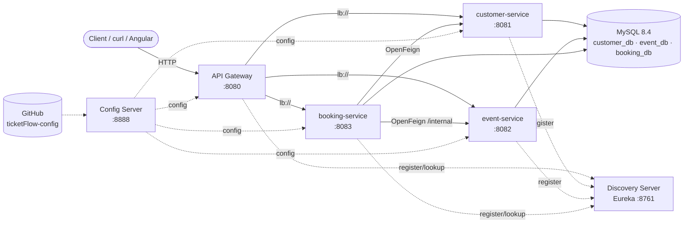

# TicketFlow

TicketFlow is an event ticketing platform built as a **Spring Boot / Spring Cloud microservices** system. Users can browse events, manage customer accounts, and book seats. Each business domain runs as an independent service with its own database. All services run in Docker containers, and their configuration is centralized in a Git repository.

> Academic project for the *Architecture microservices* course (Pr. AHAIDOUS, 2026/2027), built against the TicketFlow *cahier des charges* and the course labs TP1 to TP4.

---

## Table of contents

- [Architecture](#architecture)
- [Tech stack](#tech-stack)
- [Services and ports](#services-and-ports)
- [Project structure](#project-structure)
- [Getting started](#getting-started)
- [Centralized configuration](#centralized-configuration)
- [API reference](#api-reference)
- [Service-to-service communication (OpenFeign)](#service-to-service-communication-openfeign)
- [Databases](#databases)
- [Docker setup](#docker-setup)
- [Testing](#testing)
- [Security notes](#security-notes)
- [Known limitations](#known-limitations)
- [Roadmap](#roadmap)

---

## Architecture



There are three separate flows:

| Flow | Path |
|---|---|
| **Configuration** | GitHub → Config Server :8888 → every client service at startup |
| **Discovery** | Every service registers with Eureka :8761; the gateway and Feign clients resolve names through it |
| **Business traffic** | Client → API Gateway :8080 → business service. Internal calls go service to service through Feign, never through the gateway |

---

## Tech stack

| Area | Technology |
|---|---|
| Language | Java 21 |
| Framework | Spring Boot 4.0.8 |
| Cloud | Spring Cloud 2025.1.3 (Gateway Server WebFlux, Netflix Eureka, Config, OpenFeign) |
| Persistence | Spring Data JPA, Hibernate (`ddl-auto: update`) |
| Database | MySQL 8.4 (runtime), H2 (tests only) |
| Build | Maven multi-module (`ticketflow-parent`) with the Maven wrapper |
| Containers | Docker (multi-stage images), Docker Compose |
| CI | GitHub Actions (`./mvnw clean verify`) |

---

## Services and ports

| Service | Port | Published on host | Role |
|---|---|---|---|
| `api-gateway` | 8080 | yes (public entry point) | Single entry point, explicit routes only |
| `discovery-server` | 8761 | `127.0.0.1` only | Eureka service registry and dashboard |
| `config-server` | 8888 | no | Serves configuration from the GitHub config repo |
| `customer-service` | 8081 | no | Customer accounts and profiles |
| `event-service` | 8082 | no | Event catalogue, publication and seat inventory |
| `booking-service` | 8083 | no | Bookings; validates customers and reserves seats through Feign |
| `mysql` | 3306 | `127.0.0.1` only | One server, one database per service |

Business services can only be reached through the gateway. MySQL and Eureka are bound to `127.0.0.1`, so they're reachable from the developer's machine but not from the network.

---

## Project structure

```
ticketflow/
├── pom.xml                          # ticketflow-parent (BOM, modules)
├── docker-compose.yml               # whole stack
├── .env.example                     # template for secrets (copy to .env)
├── .dockerignore
├── docker/
│   └── mysql/init/
│       └── 01-create-databases.sh   # creates the 3 databases and their users
└── services/
    ├── api-gateway/
    ├── discovery-server/
    ├── config-server/
    ├── customer-service/
    ├── event-service/
    └── booking-service/
```

The configuration lives in a **separate repository**, `ticketFlow-config`:

```
ticketFlow-config/
├── application.yaml          # shared by all config clients (Eureka URL, prefer-ip-address)
├── api-gateway.yaml          # gateway port and routes
├── customer-service.yaml
├── customer-service-dev.yaml # "dev" profile example
├── event-service.yaml
└── booking-service.yaml      # includes Feign timeouts
```

### Layout of a business service

`event-service` and `booking-service` follow the same layered structure:

```
com.ticketflow.<service>/
├── controller/     REST controllers: DTOs in and out, no business logic
├── dto/            Java records: XxxRequest (validated) and XxxResponse
├── entity/         JPA entities; they never leave the service layer
├── repository/     Spring Data JPA repositories
├── mapper/         hand-written entity <-> DTO mappers
├── service/        service interfaces (declarations)
│   └── impl/       service implementations
├── exception/      domain exceptions + global exception handler
└── client/         (booking-service) Feign clients
    └── dto/        records for remote responses
```

- **DTOs everywhere:** entities are never returned by the API. Each response only carries the fields the caller needs.
- **Interface and implementation are separate:** controllers depend on the service interface, not on the implementation.
- **No shared DTO module:** each service owns its records. `booking-service` has its own `EventResponse` and `CustomerResponse` containing only the fields it uses, which keeps the services independent.

---

## Getting started

### Prerequisites

- Docker and Docker Compose
- JDK 21 (only to build or run outside Docker)
- Access to the `ticketFlow-config` GitHub repository

### 1. Configure secrets

```bash
cp .env.example .env
```

Fill in `.env` with real values: the MySQL root password, the per-service database passwords, and `CONFIG_GIT_URI` (the **GitHub URL** of the config repo). `.env` is git-ignored and must never be committed.

> ⚠️ `CONFIG_GIT_URI` must be the GitHub URL. Never point it at a local clone with a `file:` URI: the Config Server would reset that folder and erase unpushed commits.

### 2. Start the stack

```bash
docker compose up -d --build
docker compose ps        # wait until every container is "healthy"
```

Startup order is enforced with health checks:

```
mysql + config-server → discovery-server → customer-service → event-service → booking-service → api-gateway
```

### 3. Check that it's running

- Eureka dashboard: <http://localhost:8761>. CUSTOMER-SERVICE, EVENT-SERVICE, BOOKING-SERVICE and API-GATEWAY should be **UP**. The Config Server is intentionally not registered.
- Gateway routes: `curl http://localhost:8080/actuator/gateway/routes`

### 4. Stop

```bash
docker compose down        # keeps the MySQL data volume
docker compose down -v     # also deletes the database data
```

### Running a service outside Docker

MySQL is published on `127.0.0.1:3306`, so a service can run locally against the Dockerized database:

```bash
export DB_USERNAME=<service user> DB_PASSWORD=<service password>
./mvnw -pl services/event-service spring-boot:run
```

All hosts default to `localhost` (`CONFIG_SERVER_URL`, `EUREKA_URL`, `DB_HOST`), so no extra settings are needed locally.

---

## Centralized configuration

Every client service keeps only three settings locally: its name, the config import and the Git label. Everything else (ports, datasource, JPA, routes, Feign timeouts) comes from the `ticketFlow-config` repository through the Config Server.

```yaml
spring:
  application:
    name: event-service
  config:
    import: "configserver:${CONFIG_SERVER_URL:http://localhost:8888}"
  cloud:
    config:
      label: main
```

- The import has **no `optional:` prefix**, so a service refuses to start if its configuration can't be loaded.
- Host names use placeholders with `localhost` defaults, so the same configuration works inside Docker and on the host.
- **No secrets** are stored in the config repo. Passwords are referenced as `${DB_PASSWORD}` and come from the environment.

### Inspect what the Config Server serves

From inside the Docker network, or with config-server running locally:

```bash
curl http://localhost:8888/event-service/default/main
curl http://localhost:8888/customer-service/dev/main   # "dev" profile
```

### Refresh a value without restarting

```bash
# 1. change ticketflow.message in customer-service.yaml, commit and push
# 2. ask the running instance to reload its configuration
curl -X POST http://localhost:8081/actuator/refresh
curl http://localhost:8081/api/config/message
```

Only `@RefreshScope` beans pick up the change. Structural settings (ports, datasources, routes) still need a restart.

### customer-service in Docker

customer-service's own files are intentionally left unchanged, and its packaged `application.yml` points at `localhost:8888`. In Docker, Compose replaces that file entirely with four environment variables:

| Variable | Purpose |
|---|---|
| `SPRING_CONFIG_LOCATION=optional:file:/app/config/` | Stops the packaged `application.yml` from loading |
| `SPRING_APPLICATION_NAME=customer-service` | Replaces the name from that file |
| `SPRING_CLOUD_CONFIG_LABEL=main` | Replaces the Git label |
| `SPRING_CONFIG_IMPORT=configserver:http://config-server:8888` | Replaces the import, pointing at the config-server container |

As a result, every customer-service setting used in Docker (datasource, `ddl-auto`, `open-in-view`) is defined in `customer-service.yaml` in the config repo.

---

## API reference

All public endpoints are called through the gateway at `http://localhost:8080`.

### Customers: `/api/customers`

| Method | Path | Description |
|---|---|---|
| POST | `/api/customers` | Create a customer → `201` + `Location` |
| GET | `/api/customers` | List customers |
| GET | `/api/customers/{id}` | Get one customer (`404` if missing) |
| PUT | `/api/customers/{id}` | Update a customer |
| DELETE | `/api/customers/{id}` | Delete a customer |

Emails are unique regardless of letter case (duplicate → `409`).

```bash
curl -i -X POST http://localhost:8080/api/customers \
  -H 'Content-Type: application/json' \
  -d '{"firstName":"Salma","lastName":"Alaoui","email":"salma@example.com"}'
```

### Events: `/api/events`

| Method | Path | Description |
|---|---|---|
| POST | `/api/events` | Create an event in `DRAFT` status → `201` + `Location` |
| GET | `/api/events?page=0&size=20` | List **published** events (page size 1 to 50, otherwise `400`) |
| GET | `/api/events/{id}` | Get a published event (`404` if missing or not published) |
| PATCH | `/api/events/{id}/publish` | `DRAFT` → `PUBLISHED` |
| PATCH | `/api/events/{id}/close` | `PUBLISHED` → `CLOSED` |

Invalid status transitions return `409`. Drafts are never visible publicly.

```bash
curl -i -X POST http://localhost:8080/api/events \
  -H 'Content-Type: application/json' \
  -d '{"title":"Jazz Night","description":"Live jazz","venue":"Théâtre Mohammed V",
       "city":"Rabat","startDateTime":"2026-12-20T20:00:00","price":150.00,"capacity":100}'

curl -i -X PATCH http://localhost:8080/api/events/1/publish
```

### Bookings: `/api/bookings`

| Method | Path | Description |
|---|---|---|
| POST | `/api/bookings` | Create a booking → `201` + `Location` |
| GET | `/api/bookings/{id}` | Get one booking |
| GET | `/api/bookings?customerId={id}` | List a customer's bookings (paginated) |

```bash
curl -i -X POST http://localhost:8080/api/bookings \
  -H 'Content-Type: application/json' \
  -d '{"customerId":1,"eventId":1,"quantity":3}'
```

| Case | Response |
|---|---|
| Valid booking | `201`, status `PENDING_PAYMENT`, price snapshot and total |
| Unknown customer | `404` "customer not found" |
| Unknown event | `404` "event not found" |
| Event not published | `409` |
| Not enough seats | `409` "not enough seats" (seats unchanged) |
| Quantity outside 1 to 10 | `400` |
| event-service or customer-service unavailable | `503` |

> `customerId` in the request body is temporary. Once authentication (Keycloak/JWT) is added, the customer's identity will come from the token.

### Internal endpoints (not routed by the gateway)

Used only by `booking-service`. They return `404` when called through `:8080`.

| Method | Path | Description |
|---|---|---|
| GET | `/internal/events/{id}` | Status, available seats and price |
| POST | `/internal/events/{id}/reservations` | Reserve seats atomically → `409` if not enough seats or not published |
| POST | `/internal/events/{id}/releases` | Return seats (capped at capacity), used for compensation |

### Error format

Every service returns structured errors with no stack traces:

```json
{
  "status": 409,
  "error": "Conflict",
  "message": "not enough seats",
  "path": "/api/bookings",
  "timestamp": "2026-11-15T21:00:00Z"
}
```

---

## Service-to-service communication (OpenFeign)

`booking-service` declares two Feign clients, located through Eureka by service name (there is no hard-coded URL and the calls don't go through the gateway):

```java
@FeignClient(name = "event-service")
public interface EventClient { ... }        // /internal/events/...

@FeignClient(name = "customer-service")
public interface CustomerClient { ... }     // GET /api/customers/{id}
```

**Booking creation flow** (in `BookingServiceImpl`):

```
1. Validate the request (quantity 1..10)
2. CustomerClient  → the customer must exist                 (404)
3. EventClient GET → the event must exist and be PUBLISHED   (404 / 409)
4. EventClient POST reservations → atomic seat reservation   (409 if not enough)
5. Save the booking with a price snapshot
   ↳ if the save fails: EventClient POST releases (compensation), then rethrow
```

- **Error mapping:** a custom `ErrorDecoder` turns remote `404` and `409` responses into domain exceptions. Connection errors and timeouts become `503`. A remote error is never turned into a success.
- **Timeouts** (in `booking-service.yaml`): `connectTimeout: 2000 ms`, `readTimeout: 3000 ms`. There are no automatic retries on POST requests.
- **No database transaction during remote calls:** `create()` doesn't hold a database connection while waiting on HTTP calls.

### Atomic seat reservation

`event-service` reserves seats with a single conditional SQL update:

```sql
UPDATE event
SET available_seats = available_seats - :quantity
WHERE id = :id AND status = 'PUBLISHED' AND available_seats >= :quantity
```

If no row is updated, the reservation is refused, so the seat count can never go negative. A concurrency test sends 30 parallel one-seat reservations against a 10-seat event: exactly 10 succeed.

---

## Databases

One MySQL 8.4 server (container `mysql`) hosts one database per service. Each database has its own user, with privileges **only** on that database:

| Database | Owner service | User |
|---|---|---|
| `customer_db` | customer-service | its own user |
| `event_db` | event-service | its own user |
| `booking_db` | booking-service | its own user |

- The databases and users are created at the first start by `docker/mysql/init/01-create-databases.sh`, which reads passwords from the environment.
- No service reads another service's database. Data from another domain is fetched through REST.
- Schema management: Hibernate `ddl-auto: update`.
- Data is stored in a named Docker volume and survives `docker compose down`.

---

## Docker setup

Every service uses the same **two-stage Dockerfile** (`services/<service>/Dockerfile`, built from the repository root):

1. **Build stage** (JDK 21 + Maven wrapper): copies the POMs first and resolves dependencies in a cached layer, then builds only this module with `./mvnw -pl services/<service> -am package -DskipTests`.
2. **Run stage** (JRE 21 only): contains only the built jar, with no sources and no build tools.

Security and operations:

- 🔒 **Non-root:** containers run as user `ticketflow` (UID/GID `10001`).
- ❤️ **Health checks:** `HEALTHCHECK` on `/actuator/health`; Compose uses `depends_on: condition: service_healthy` to start services in order.
- 📌 **Pinned base images**, no `latest`.
- 🧠 **Container-aware JVM** (`-XX:MaxRAMPercentage`).
- One internal Docker network. Only the gateway is exposed publicly.

> When a new Maven module is added, every Dockerfile needs one extra `COPY` line for its `pom.xml`, because the Maven reactor needs all module POMs.

---

## Testing

```bash
./mvnw clean verify
```

- Tests run without Docker, the Config Server or MySQL. Each client has a test configuration file with no config import, and the tests use **H2**.
- They include unit tests for the services (Mockito, with mocked Feign clients in booking-service), controller tests (MockMvc), and repository tests (including the concurrent seat reservation test).
- booking-service tests cover: success, unknown customer, unknown event, event not published, not enough seats, event-service down (`503`), and compensation when the save fails.
- CI runs the same command on GitHub Actions.

---

## Security notes

- Secrets only live in `.env` (git-ignored). `.env.example` contains fake values.
- The config repository contains **no** passwords or tokens, only placeholders.
- MySQL and Eureka are bound to `127.0.0.1`. Config Server and business services aren't published at all.
- Internal endpoints (`/internal/**`) aren't routed by the gateway.
- Containers don't run as root.
- Gateway routes are explicit. Discovery-based automatic routing is disabled, so a newly registered service isn't exposed automatically.

---

## Known limitations

- **No authentication yet.** `customerId` is sent in the booking request body. It will come from the JWT once Keycloak is added.
- **Reservation timeout gap.** If the reservation call times out *after* event-service has already reserved the seats, those seats aren't released. This will be handled by a saga or outbox approach.
- **Bookings stay in `PENDING_PAYMENT`.** There is no payment service or booking expiry yet.
- **`releases` isn't tied to a booking.** Any internal caller can return seats (up to capacity). It should become idempotent and linked to a booking ID.
- **Compensation can be rejected by an open circuit.** If saving a booking fails after the seats were reserved, booking-service calls `releases` to give them back. If the `event-service` circuit breaker is OPEN at that moment, the release is never sent: the seats stay reserved. booking-service logs it as `COMPENSATION NOT SENT ... seat(s) of event N stay reserved: release them manually` (customer, event and quantity; there is no booking ID because the booking was not saved). The future saga step will retry the release from a durable record.
- **No retries.** A failed call is never retried (a `POST` reservation must not be sent twice). Bounded, idempotent retries come with the saga.
- **Schema managed by Hibernate (`ddl-auto: update`).** Versioned migrations (Flyway) are recommended for production.

---

## Roadmap

Based on the TicketFlow *cahier des charges*:

- [x] API Gateway with explicit routes (TP1)
- [x] Service discovery with Eureka (TP2)
- [x] Centralized configuration with Config Server and GitHub (TP3)
- [x] Customer, Event and Booking services
- [x] OpenFeign communication between booking, event and customer services (TP4)
- [x] Docker Compose, MySQL with one database per service, non-root containers, health checks
- [x] Resilience4j circuit breakers, one per Feign client (TP5)
- [ ] Bounded, idempotent retries
- [ ] Kafka domain events (`BookingCreated`, `BookingConfirmed`, …) and a Notification Service
- [ ] Keycloak (OIDC/JWT): authentication, roles, identity from the token
- [ ] Simulated Payment Service and Ticket Service
- [ ] Booking expiry and cancellation
- [ ] AI Assistant Service and MCP Tool Server, with a Telegram bot
- [ ] Angular web front end
- [ ] OpenAPI documentation and `/api/v1` versioning

---
