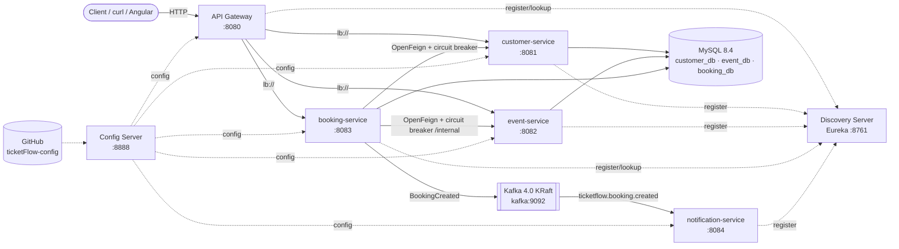

# TicketFlow

TicketFlow is an event ticketing platform built as a **Spring Boot / Spring Cloud microservices** system. Users can browse events, manage customer accounts, and book seats. Each business domain runs as an independent service with its own database. All services run in Docker containers, and their configuration is centralized in a Git repository. Calls between services are protected by circuit breakers, and services publish domain events through Kafka.

> Academic project for the *Architecture microservices* course (Pr. AHAIDOUS, 2026/2027), built against the TicketFlow *cahier des charges* and the course labs TP1 to TP6.

---

## Table of contents

- [Architecture](#architecture)
- [Tech stack](#tech-stack)
- [Services and ports](#services-and-ports)
- [Project structure](#project-structure)
- [Getting started](#getting-started)
- [Centralized configuration](#centralized-configuration)
- [API reference](#api-reference)
- [Service-to-service communication (OpenFeign)](#service-to-service-communication-openfeign)
- [Circuit breakers (Resilience4j)](#circuit-breakers-resilience4j)
- [Messaging (Kafka)](#messaging-kafka)
- [Databases](#databases)
- [Docker setup](#docker-setup)
- [Testing](#testing)
- [Security notes](#security-notes)
- [Known limitations](#known-limitations)
- [Roadmap](#roadmap)

---

## Architecture



There are four separate flows:

| Flow | Path |
|---|---|
| **Configuration** | GitHub → Config Server :8888 → every client service at startup |
| **Discovery** | Every service registers with Eureka :8761; the gateway and Feign clients resolve names through it |
| **Business traffic** | Client → API Gateway :8080 → business service. Internal calls go service to service through Feign (each client behind its own circuit breaker), never through the gateway |
| **Events** | booking-service → Kafka topic → consumers (notification-service). Asynchronous: the producer does not wait for, or know about, its consumers |

---

## Tech stack

| Area | Technology |
|---|---|
| Language | Java 21 |
| Framework | Spring Boot 4.0.8 |
| Cloud | Spring Cloud 2025.1.3 (Gateway Server WebFlux, Netflix Eureka, Config, OpenFeign, CircuitBreaker Resilience4j) |
| Messaging | Apache Kafka 4.0 (KRaft, no ZooKeeper), Spring for Apache Kafka |
| Persistence | Spring Data JPA, Hibernate (`ddl-auto: update`) |
| Database | MySQL 8.4 (runtime), H2 (tests only) |
| Build | Maven multi-module (`ticketflow-parent`) with the Maven wrapper |
| Containers | Docker (multi-stage images), Docker Compose |
| CI | GitHub Actions (`./mvnw clean verify`) |

---

## Services and ports

| Service | Port | Published on host | Role |
|---|---|---|---|
| `api-gateway` | 8080 | yes (public entry point) | Single entry point, explicit routes only |
| `discovery-server` | 8761 | `127.0.0.1` only | Eureka service registry and dashboard |
| `config-server` | 8888 | no | Serves configuration from the GitHub config repo |
| `customer-service` | 8081 | no | Customer accounts and profiles |
| `event-service` | 8082 | no | Event catalogue, publication and seat inventory |
| `booking-service` | 8083 | no | Bookings; validates customers and reserves seats through Feign; publishes `BookingCreated` |
| `notification-service` | 8084 | no | Consumes booking events and sends notifications (logged for now); no HTTP API |
| `mysql` | 3306 | `127.0.0.1` only | One server, one database per service |
| `kafka` | 9092 (internal), 9094 (host), 9093 (controller) | 9094 on `127.0.0.1` only | Single Kafka broker + KRaft controller |
| `kafka-init` | – | no | One-shot container: creates the topics, then exits `0` |

Business services can only be reached through the gateway. MySQL, Eureka and Kafka's host listener are bound to `127.0.0.1`, so they're reachable from the developer's machine but not from the network.

---

## Project structure

```
ticketflow/
├── pom.xml                          # ticketflow-parent (BOM, modules)
├── docker-compose.yml               # whole stack
├── .env.example                     # template for secrets (copy to .env)
├── .dockerignore
├── docker/
│   ├── mysql/init/
│   │   └── 01-create-databases.sh   # creates the 3 databases and their users
│   └── kafka/
│       └── create-topics.sh         # run by kafka-init: creates the topics (idempotent)
├── docs/
│   └── kafka-cli.md                 # Kafka CLI cheat sheet for this stack
└── services/
    ├── api-gateway/
    ├── discovery-server/
    ├── config-server/
    ├── customer-service/
    ├── event-service/
    ├── booking-service/
    └── notification-service/
```

The configuration lives in a **separate repository**, `ticketFlow-config`:

```
ticketFlow-config/
├── application.yaml          # shared by all config clients (Eureka URL, prefer-ip-address, Kafka bootstrap servers)
├── api-gateway.yaml          # gateway port and routes
├── customer-service.yaml
├── customer-service-dev.yaml # "dev" profile example
├── event-service.yaml
├── booking-service.yaml      # Feign timeouts, circuit breakers, Kafka producer
└── notification-service.yaml # port, Kafka consumer
```

### Layout of a business service

`event-service` and `booking-service` follow the same layered structure:

```
com.ticketflow.<service>/
├── controller/     REST controllers: DTOs in and out, no business logic
├── dto/            Java records: XxxRequest (validated), XxxResponse, and (booking) BookingCreatedEvent
├── entity/         JPA entities; they never leave the service layer
├── repository/     Spring Data JPA repositories
├── mapper/         hand-written entity <-> DTO mappers
├── service/        service interfaces (declarations)
│   └── impl/       service implementations (booking: also the Kafka publisher)
├── exception/      domain exceptions + global exception handler
└── client/         (booking-service) Feign clients, error decoder,
    │               circuit breaker naming and health indicator
    └── dto/        records for remote responses
```

`notification-service` has no database and no REST API:

```
com.ticketflow.notificationservice/
├── listener/       @KafkaListener: reads and validates the JSON message
├── dto/            its own copy of the BookingCreated contract
└── service/        NotificationService (+ impl/: de-duplication, "send")
```

- **DTOs everywhere:** entities are never returned by the API. Each response only carries the fields the caller needs.
- **Interface and implementation are separate:** controllers depend on the service interface, not on the implementation.
- **No shared DTO module:** each service owns its records. `booking-service` has its own `EventResponse` and `CustomerResponse` containing only the fields it uses, and `notification-service` has its own `BookingCreatedEvent`. This keeps the services independent.

---

## Getting started

### Prerequisites

- Docker and Docker Compose
- JDK 21 (only to build or run outside Docker)
- Access to the `ticketFlow-config` GitHub repository

### 1. Configure secrets

```bash
cp .env.example .env
```

Fill in `.env` with real values: the MySQL root password, the per-service database passwords, and `CONFIG_GIT_URI` (the **GitHub URL** of the config repo). `.env` is git-ignored and must never be committed.

> ⚠️ `CONFIG_GIT_URI` must be the GitHub URL. Never point it at a local clone with a `file:` URI: the Config Server would reset that folder and erase unpushed commits.

### 2. Start the stack

```bash
docker compose up -d --build
docker compose ps        # wait until every container is "healthy" (kafka-init: "Exited (0)")
```

Startup order is enforced with health checks:

```
mysql + config-server → discovery-server → customer-service → event-service → booking-service → api-gateway
kafka → kafka-init (topics) → notification-service
```

booking-service deliberately does **not** wait for Kafka: bookings keep working when the broker is down (see [Messaging](#messaging-kafka)).

### 3. Check that it's running

- Eureka dashboard: <http://localhost:8761>. CUSTOMER-SERVICE, EVENT-SERVICE, BOOKING-SERVICE, NOTIFICATION-SERVICE and API-GATEWAY should be **UP**. The Config Server is intentionally not registered.
- Gateway routes: `curl http://localhost:8080/actuator/gateway/routes`
- Kafka topics: `docker compose exec kafka /opt/kafka/bin/kafka-topics.sh --bootstrap-server kafka:9092 --list`
- Circuit breakers: `docker compose exec booking-service curl -s localhost:8083/actuator/circuitbreakers`

### 4. Stop

```bash
docker compose down        # keeps the MySQL and Kafka data volumes
docker compose down -v     # also deletes the database and Kafka data
```

### Running a service outside Docker

MySQL is published on `127.0.0.1:3306` and Kafka on `127.0.0.1:9094`, so a service can run locally against the Dockerized infrastructure:

```bash
export DB_USERNAME=<service user> DB_PASSWORD=<service password>
./mvnw -pl services/event-service spring-boot:run
```

All hosts default to `localhost` (`CONFIG_SERVER_URL`, `EUREKA_URL`, `DB_HOST`, and `KAFKA_BOOTSTRAP_SERVERS` → `localhost:9094`), so no extra settings are needed locally.

---

## Centralized configuration

Every client service keeps only three settings locally: its name, the config import and the Git label. Everything else (ports, datasource, JPA, routes, Feign timeouts, circuit breakers, Kafka) comes from the `ticketFlow-config` repository through the Config Server.

```yaml
spring:
  application:
    name: event-service
  config:
    import: "configserver:${CONFIG_SERVER_URL:http://localhost:8888}"
  cloud:
    config:
      label: main
```

- The import has **no `optional:` prefix**, so a service refuses to start if its configuration can't be loaded.
- Host names use placeholders with `localhost` defaults, so the same configuration works inside Docker and on the host.
- **No secrets** are stored in the config repo. Passwords are referenced as `${DB_PASSWORD}` and come from the environment.

### Inspect what the Config Server serves

From inside the Docker network, or with config-server running locally:

```bash
curl http://localhost:8888/event-service/default/main
curl http://localhost:8888/customer-service/dev/main   # "dev" profile
```

### Refresh a value without restarting

```bash
# 1. change ticketflow.message in customer-service.yaml, commit and push
# 2. ask the running instance to reload its configuration
curl -X POST http://localhost:8081/actuator/refresh
curl http://localhost:8081/api/config/message
```

Only `@RefreshScope` beans pick up the change. Structural settings (ports, datasources, routes, circuit breakers, Kafka clients) still need a restart.

### customer-service in Docker

customer-service's own files are intentionally left unchanged, and its packaged `application.yml` points at `localhost:8888`. In Docker, Compose replaces that file entirely with four environment variables:

| Variable | Purpose |
|---|---|
| `SPRING_CONFIG_LOCATION=optional:file:/app/config/` | Stops the packaged `application.yml` from loading |
| `SPRING_APPLICATION_NAME=customer-service` | Replaces the name from that file |
| `SPRING_CLOUD_CONFIG_LABEL=main` | Replaces the Git label |
| `SPRING_CONFIG_IMPORT=configserver:http://config-server:8888` | Replaces the import, pointing at the config-server container |

As a result, every customer-service setting used in Docker (datasource, `ddl-auto`, `open-in-view`) is defined in `customer-service.yaml` in the config repo.

---

## API reference

All public endpoints are called through the gateway at `http://localhost:8080`.

### Customers: `/api/customers`

| Method | Path | Description |
|---|---|---|
| POST | `/api/customers` | Create a customer → `201` + `Location` |
| GET | `/api/customers` | List customers |
| GET | `/api/customers/{id}` | Get one customer (`404` if missing) |
| PUT | `/api/customers/{id}` | Update a customer |
| DELETE | `/api/customers/{id}` | Delete a customer |

Emails are unique regardless of letter case (duplicate → `409`).

```bash
curl -i -X POST http://localhost:8080/api/customers \
  -H 'Content-Type: application/json' \
  -d '{"firstName":"Salma","lastName":"Alaoui","email":"salma@example.com"}'
```

### Events: `/api/events`

| Method | Path | Description |
|---|---|---|
| POST | `/api/events` | Create an event in `DRAFT` status → `201` + `Location` |
| GET | `/api/events?page=0&size=20` | List **published** events (page size 1 to 50, otherwise `400`) |
| GET | `/api/events/{id}` | Get a published event (`404` if missing or not published) |
| PATCH | `/api/events/{id}/publish` | `DRAFT` → `PUBLISHED` |
| PATCH | `/api/events/{id}/close` | `PUBLISHED` → `CLOSED` |

Invalid status transitions return `409`. Drafts are never visible publicly.

```bash
curl -i -X POST http://localhost:8080/api/events \
  -H 'Content-Type: application/json' \
  -d '{"title":"Jazz Night","description":"Live jazz","venue":"Théâtre Mohammed V",
       "city":"Rabat","startDateTime":"2026-12-20T20:00:00","price":150.00,"capacity":100}'

curl -i -X PATCH http://localhost:8080/api/events/1/publish
```

### Bookings: `/api/bookings`

| Method | Path | Description |
|---|---|---|
| POST | `/api/bookings` | Create a booking → `201` + `Location` |
| GET | `/api/bookings/{id}` | Get one booking |
| GET | `/api/bookings?customerId={id}` | List a customer's bookings (paginated) |

```bash
curl -i -X POST http://localhost:8080/api/bookings \
  -H 'Content-Type: application/json' \
  -d '{"customerId":1,"eventId":1,"quantity":3}'
```

| Case | Response |
|---|---|
| Valid booking | `201`, status `PENDING_PAYMENT`, price snapshot and total; `BookingCreated` published to Kafka |
| Unknown customer | `404` "customer not found" |
| Unknown event | `404` "event not found" |
| Event not published | `409` |
| Not enough seats | `409` "not enough seats" (seats unchanged) |
| Quantity outside 1 to 10 | `400` |
| event-service or customer-service unavailable | `503` "… is unavailable, try again later" |
| Circuit breaker open for that dependency | `503` "… is unavailable (circuit breaker open), try again later", answered immediately, no remote call |
| Kafka unavailable | still `201`: the booking is saved, the missing event is logged (see [Messaging](#messaging-kafka)) |

> `customerId` in the request body is temporary. Once authentication (Keycloak/JWT) is added, the customer's identity will come from the token.

### Internal endpoints (not routed by the gateway)

Used only by `booking-service`. They return `404` when called through `:8080`.

| Method | Path | Description |
|---|---|---|
| GET | `/internal/events/{id}` | Status, available seats and price |
| POST | `/internal/events/{id}/reservations` | Reserve seats atomically → `409` if not enough seats or not published |
| POST | `/internal/events/{id}/releases` | Return seats (capped at capacity), used for compensation |

### Error format

Every service returns structured errors with no stack traces:

```json
{
  "status": 409,
  "error": "Conflict",
  "message": "not enough seats",
  "path": "/api/bookings",
  "timestamp": "2026-11-15T21:00:00Z"
}
```

---

## Service-to-service communication (OpenFeign)

`booking-service` declares two Feign clients, located through Eureka by service name (there is no hard-coded URL and the calls don't go through the gateway):

```java
@FeignClient(name = "event-service")
public interface EventClient { ... }        // /internal/events/...

@FeignClient(name = "customer-service")
public interface CustomerClient { ... }     // GET /api/customers/{id}
```

**Booking creation flow** (in `BookingServiceImpl`):

```
1. Validate the request (quantity 1..10)
2. CustomerClient  → the customer must exist                 (404)
3. EventClient GET → the event must exist and be PUBLISHED   (404 / 409)
4. EventClient POST reservations → atomic seat reservation   (409 if not enough)
5. Save the booking with a price snapshot
   ↳ if the save fails: EventClient POST releases (compensation), then rethrow
6. Publish BookingCreated to Kafka (best effort, never fails the booking)
```

- **Error mapping:** a custom `ErrorDecoder` turns remote `404` and `409` responses into domain exceptions. Connection errors, timeouts, remote `5xx` and an open circuit become `503`. A remote error is never turned into a success.
- **Timeouts** (in `booking-service.yaml`): `connectTimeout: 2000 ms`, `readTimeout: 3000 ms`. There are no automatic retries on POST requests.
- **Circuit breakers:** every Feign call runs inside its client's circuit breaker, see the [next section](#circuit-breakers-resilience4j).
- **No database transaction during remote calls:** `create()` doesn't hold a database connection while waiting on HTTP calls.

### Atomic seat reservation

`event-service` reserves seats with a single conditional SQL update:

```sql
UPDATE event
SET available_seats = available_seats - :quantity
WHERE id = :id AND status = 'PUBLISHED' AND available_seats >= :quantity
```

If no row is updated, the reservation is refused, so the seat count can never go negative. A concurrency test sends 30 parallel one-seat reservations against a 10-seat event: exactly 10 succeed.

---

## Circuit breakers (Resilience4j)

booking-service wraps its Feign calls in Resilience4j circuit breakers (`spring.cloud.openfeign.circuitbreaker.enabled`, group mode). When a dependency keeps failing, the breaker **opens**: later calls are rejected immediately with `503`, without waiting for timeouts and without loading the failing service. After a pause, a few trial calls decide whether it closes again.

### One breaker per dependency

There are exactly two breakers, named after the Feign clients: **`event-service`** and **`customer-service`**. A customer-service outage never blocks calls to event-service, and the reverse.

> Group mode alone is not enough. Spring Cloud OpenFeign still names breakers **per method** (e.g. `EventClientgetEventLong`); the group only shares their configuration and thread pool. With per-method breakers, failed `getEvent` calls would open one breaker while `reserveSeats` and `releaseSeats` kept calling a dead service. `client/FeignCircuitBreakerConfig` therefore names each breaker after its Feign client.

### Settings (`booking-service.yaml`, both breakers)

| Setting | Value | Meaning |
|---|---|---|
| `sliding-window-type` / `sliding-window-size` | `COUNT_BASED` / 10 | The failure rate is computed over the last 10 calls |
| `minimum-number-of-calls` | 5 | No decision before 5 calls |
| `failure-rate-threshold` | 50 % | At or above it → OPEN |
| `wait-duration-in-open-state` | 10 s | Time spent OPEN before trial calls are allowed |
| `permitted-number-of-calls-in-half-open-state` | 3 | Trial calls in HALF_OPEN; all good → CLOSED |
| time limiter `timeout-duration` | 4 s | Above Feign's 3 s read timeout, so Feign's own timeout fires first |

**What counts as a failure:** only technical problems. These are connection refused, connect or read timeouts (`feign.RetryableException`), remote `5xx` or "no instance registered" (`ServiceUnavailableException`), and time limiter timeouts.

**What never opens the circuit:** business answers. An unknown event or customer (`404`), a DRAFT event or not enough seats (`409`), and validation errors are configured as `ignore-exceptions`. They are neither failures nor successes for the breaker.

There is **no fallback that pretends success.** No fake event is returned, and no booking is created or confirmed while a dependency is down: the client gets a `503`.

### Observe it

The endpoints are internal: booking-service's port isn't published and the gateway doesn't route `/actuator/**` for it.

```bash
# State, failure rate and call counts of each breaker
docker compose exec booking-service curl -s localhost:8083/actuator/circuitbreakers

# Recent events: errors, state transitions, rejected calls
docker compose exec booking-service curl -s localhost:8083/actuator/circuitbreakerevents/event-service

# Health shows the state of each breaker (components.circuitBreakers)
docker compose exec booking-service curl -s localhost:8083/actuator/health
```

The health status stays `UP` when a breaker is OPEN. An open breaker means a *dependency* is down: booking-service itself still answers (fast `503`s, reads of existing bookings), and reporting `DOWN` would mark its container unhealthy for nothing.

> resilience4j-spring-boot3's own health indicator targets Spring Boot 3 packages and is silently skipped on Boot 4, so booking-service ships its own (`client/CircuitBreakersHealthIndicator`).

### Try it

```bash
docker compose stop event-service
for i in $(seq 1 10); do
  curl -s -o /dev/null -w "call $i: %{http_code} %{time_total}s\n" -X POST localhost:8080/api/bookings \
    -H 'Content-Type: application/json' -d '{"customerId":1,"eventId":1,"quantity":1}'
done
docker compose start event-service      # wait > 10 s, then book again: HALF_OPEN → CLOSED
```

Measured on this stack: calls 1–5 return `503` after about 2 s each (connect timeout). The **5th failure** opens the circuit, because 5 calls is the minimum and the failure rate is then at least 50 %. Calls 6–10 return `503` in under 20 ms, with no request sent to event-service. No booking is saved and no seat is reserved. After the restart and the 10 s wait, the first trial calls move the breaker to HALF_OPEN, and after 3 successful calls it is CLOSED. One booking makes 2 calls to event-service (GET + reservation).

---

## Messaging (Kafka)

### Broker

One Kafka 4.0 node in **KRaft** mode (broker and controller in one process, no ZooKeeper), image `apache/kafka:4.0.0`, running as the non-root user `appuser`. Its data lives in the named volume `kafka-data`, so topics and messages survive `restart` and `down`/`up`.

| Listener | Address | Used by |
|---|---|---|
| `PLAINTEXT` | `kafka:9092` | Containers on the `ticketflow` network |
| `EXTERNAL` | `localhost:9094` | The host only (published on `127.0.0.1`) |
| `CONTROLLER` | `:9093` | KRaft quorum, internal, not published |

The services read `spring.kafka.bootstrap-servers: ${KAFKA_BOOTSTRAP_SERVERS:localhost:9094}` from the shared `application.yaml`; Docker Compose sets `KAFKA_BOOTSTRAP_SERVERS=kafka:9092`.

### Topics

Created at startup by the one-shot `kafka-init` container (`docker/kafka/create-topics.sh`, `--if-not-exists`). Automatic topic creation is disabled, so a misspelled topic name fails instead of creating a new topic.

| Topic | Producer | Consumers | Partitions / RF |
|---|---|---|---|
| `ticketflow.booking.created` | booking-service | notification-service | 3 / 1 |
| `ticketflow.booking.cancelled` | (future) | | 3 / 1 |
| `ticketflow.payment.succeeded` | (future) | | 3 / 1 |
| `ticketflow.payment.failed` | (future) | | 3 / 1 |

**Key convention:** every message is keyed by `bookingId`. The same key always goes to the same partition, so the events of one booking are read in order.

### BookingCreated

Published by booking-service **after** the booking is saved:

```json
{
  "eventId": "59f17d6d-5b90-42d3-94b4-08c10a8d6588",
  "type": "BookingCreated",
  "version": 1,
  "occurredAt": "2026-11-20T21:05:44.248151294Z",
  "payload": {"bookingId": 10, "eventId": 4, "customerId": 1, "quantity": 2, "totalPrice": 200.00}
}
```

- The top-level `eventId` identifies **this message**: consumers de-duplicate on it. `payload.eventId` is the booked event. There is no personal data, only ids and amounts.
- The value is a plain JSON string with no Spring type headers. Each consumer owns its copy of the contract and ignores unknown properties, so new fields don't break it.
- **Best effort:** a Kafka outage never fails a booking. `send()` waits at most `max.block.ms` = 2 s (the default is 60 s), and the result is logged from the send callback:
  - success: `BookingCreated published: bookingId=… partition=… offset=…`
  - failure: `BookingCreated NOT published (booking is saved, event lost until the outbox exists): …`

  The producer reconnects by itself once the broker is back. See [Known limitations](#known-limitations).

### notification-service

- `@KafkaListener(groupId = "notification-service", concurrency = "3")` on `ticketflow.booking.created`: one listener thread per partition.
- Logs `Notification sent: booking N created (customer …, event …, … seat(s), total …)`. This is a simulated channel.
- **Idempotent:** Kafka delivers *at least once*, so the same message can arrive twice. The service remembers processed message ids and logs `Duplicate BookingCreated skipped` for a repeat.
- A malformed message is logged with its partition and offset, then skipped, so it can't block the partition.
- Offsets are committed after processing, with `auto-offset-reset: earliest`. If the service is stopped, the bookings created in the meantime are delivered when it restarts.

```bash
docker compose logs -f notification-service | grep -E "Notification sent|Duplicate"

# Consumer lag per partition (0 = up to date)
docker compose exec kafka /opt/kafka/bin/kafka-consumer-groups.sh \
  --bootstrap-server kafka:9092 --describe --group notification-service
```

### CLI cheat sheet

[`docs/kafka-cli.md`](docs/kafka-cli.md) has the TP6 commands adapted to this stack. It covers listing and describing topics, a keyed console producer, consumers with partition, offset and key, consumer groups and lag, offset reset (`--dry-run` / `--execute`), `kafka-get-offsets.sh`, and access from the host.

---

## Databases

One MySQL 8.4 server (container `mysql`) hosts one database per service. Each database has its own user, with privileges **only** on that database:

| Database | Owner service | User |
|---|---|---|
| `customer_db` | customer-service | its own user |
| `event_db` | event-service | its own user |
| `booking_db` | booking-service | its own user |

- The databases and users are created at the first start by `docker/mysql/init/01-create-databases.sh`, which reads passwords from the environment.
- No service reads another service's database. Data from another domain is fetched through REST, or received as Kafka events.
- notification-service has no database yet.
- Schema management: Hibernate `ddl-auto: update`.
- Data is stored in a named Docker volume and survives `docker compose down`.

---

## Docker setup

Every Spring service uses the same **two-stage Dockerfile** (`services/<service>/Dockerfile`, built from the repository root):

1. **Build stage** (JDK 21 + Maven wrapper): copies the POMs first and resolves dependencies in a cached layer, then builds only this module with `./mvnw -pl services/<service> -am package -DskipTests`.
2. **Run stage** (JRE 21 only): contains only the built jar, with no sources and no build tools.

Security and operations:

- 🔒 **Non-root:** service containers run as user `ticketflow` (UID/GID `10001`). Kafka and kafka-init run as the image's `appuser` (UID `1000`).
- ❤️ **Health checks:** `HEALTHCHECK` on `/actuator/health`, and `kafka-broker-api-versions.sh` for Kafka. Compose uses `depends_on: condition: service_healthy` (and `service_completed_successfully` for kafka-init) to start services in order.
- 📌 **Pinned images**, no `latest` (`mysql:8.4`, `apache/kafka:4.0.0`, `eclipse-temurin:21.0.9_10-*`).
- 🧠 **Container-aware JVM** (`-XX:MaxRAMPercentage`).
- One internal Docker network. Only the gateway is exposed publicly.

> When a new Maven module is added, every Dockerfile needs one extra `COPY` line for its `pom.xml`, because the Maven reactor needs all module POMs. There are 7 modules today.

---

## Testing

```bash
./mvnw clean verify
```

- Tests run without Docker, the Config Server, MySQL or a Kafka broker. Each client has a test configuration file with no config import, and the tests use **H2**.
- They include unit tests for the services (Mockito, with mocked Feign clients in booking-service), controller tests (MockMvc), and repository tests (including the concurrent seat reservation test).
- booking-service tests cover: success, unknown customer, unknown event, event not published, not enough seats, event-service down (`503`), and compensation when the save fails.
- **Circuit breakers:** `FeignCircuitBreakerTest` runs the real Feign clients, LoadBalancer and Resilience4j against a local stub server. It checks that:
  - `404`/`409` don't count as failures;
  - the breaker is OPEN after the 5th technical failure (5xx and timeouts), and the next call is rejected without a network call (`503`);
  - a customer-service outage doesn't touch the event-service breaker;
  - the breaker goes HALF_OPEN → CLOSED after successful calls.
- **Kafka:** `BookingCreated` is published after the save with the documented JSON and key. Nothing is published on errors, and a publish failure never fails the booking. In notification-service, an embedded-Kafka test checks that a duplicate is processed once, a malformed message is skipped, and an unknown JSON property is ignored.
- CI runs the same command on GitHub Actions.

---

## Security notes

- Secrets only live in `.env` (git-ignored). `.env.example` contains fake values.
- The config repository contains **no** passwords or tokens, only placeholders.
- MySQL, Eureka and Kafka's host listener (9094) are bound to `127.0.0.1`. Config Server, business services and Kafka's internal and controller listeners aren't published at all.
- Internal endpoints (`/internal/**`) and booking-service's actuator endpoints (`circuitbreakers`, `circuitbreakerevents`, `health` details) aren't routed by the gateway.
- Kafka messages carry ids and amounts only, no personal data.
- Containers don't run as root.
- Gateway routes are explicit. Discovery-based automatic routing is disabled, so a newly registered service isn't exposed automatically.

---

## Known limitations

- **No authentication yet.** `customerId` is sent in the booking request body. It will come from the JWT once Keycloak is added.
- **Reservation timeout gap.** If the reservation call times out *after* event-service has already reserved the seats, those seats aren't released. This will be handled by a saga or outbox approach.
- **Bookings stay in `PENDING_PAYMENT`.** There is no payment service or booking expiry yet.
- **`releases` isn't tied to a booking.** Any internal caller can return seats (up to capacity). It should become idempotent and linked to a booking ID.
- **Compensation can be rejected by an open circuit.** If saving a booking fails after the seats were reserved, booking-service calls `releases` to give them back. If the `event-service` circuit breaker is OPEN at that moment, the release is never sent: the seats stay reserved. booking-service logs it as `COMPENSATION NOT SENT ... seat(s) of event N stay reserved: release them manually` (customer, event and quantity; there is no booking ID because the booking was not saved). The future saga step will retry the release from a durable record.
- **No retries.** A failed call is never retried (a `POST` reservation must not be sent twice). Bounded, idempotent retries come with the saga.
- **Events can be lost (no outbox yet).** If Kafka is down when a booking is saved, its `BookingCreated` is logged as not published and is never sent later. The fix is the **transactional outbox**: write the event to an `outbox` table in the same transaction as the booking, and have a relay publish it once Kafka is reachable.
- **In-memory de-duplication.** notification-service remembers the last 10,000 processed message ids in memory, per instance. A restart, a second instance or a very old redelivery can still produce a duplicate notification. The durable fix is a processed-events table written in the same transaction as the notification.
- **No dead-letter topic.** A malformed message is logged and skipped, not parked for later inspection.
- **Single Kafka broker, no security.** There is one broker (replication factor 1, no fault tolerance), and the listeners are `PLAINTEXT` with no authentication or TLS. This is acceptable for local development only.
- **Schema managed by Hibernate (`ddl-auto: update`).** Versioned migrations (Flyway) are recommended for production.

---

## Roadmap

Based on the TicketFlow *cahier des charges*:

- [x] API Gateway with explicit routes (TP1)
- [x] Service discovery with Eureka (TP2)
- [x] Centralized configuration with Config Server and GitHub (TP3)
- [x] Customer, Event and Booking services
- [x] OpenFeign communication between booking, event and customer services (TP4)
- [x] Docker Compose, MySQL with one database per service, non-root containers, health checks
- [x] Resilience4j circuit breakers, one per Feign client (TP5)
- [x] Kafka in KRaft mode, TicketFlow topics, CLI cheat sheet (TP6)
- [x] `BookingCreated` event and a Notification Service (idempotent consumer)
- [ ] Transactional outbox, dead-letter topic, durable de-duplication
- [ ] More domain events (`BookingConfirmed`, `BookingCancelled`, payment events)
- [ ] Bounded, idempotent retries
- [ ] Keycloak (OIDC/JWT): authentication, roles, identity from the token
- [ ] Simulated Payment Service and Ticket Service
- [ ] Booking expiry and cancellation
- [ ] AI Assistant Service and MCP Tool Server, with a Telegram bot
- [ ] Angular web front end
- [ ] OpenAPI documentation and `/api/v1` versioning

---
